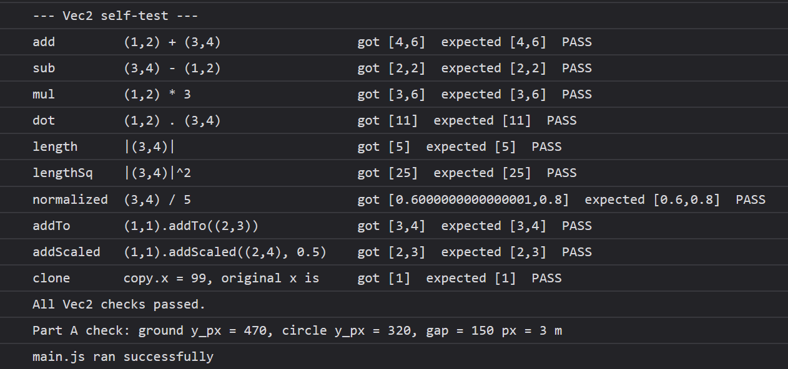
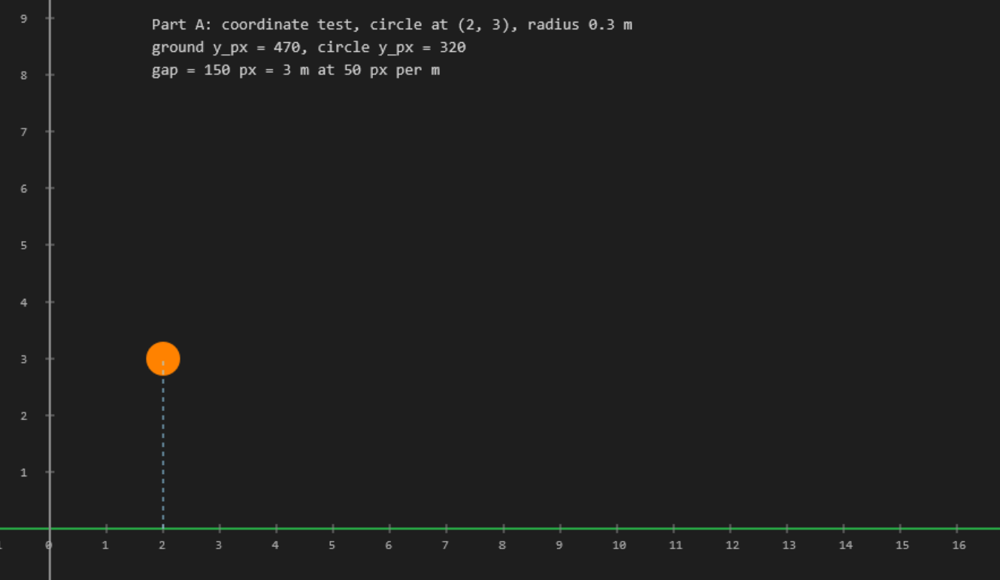
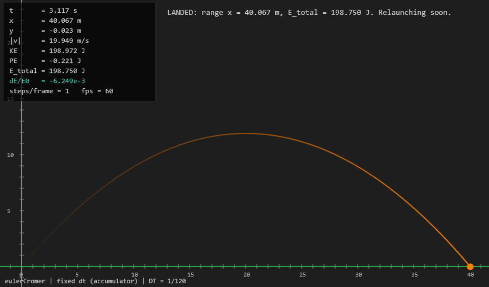
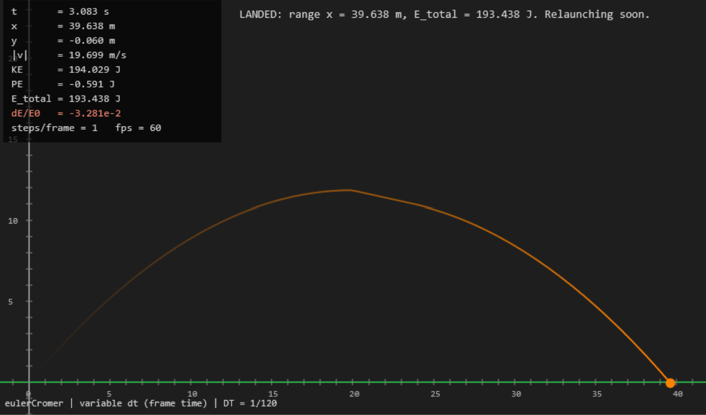

# Lab 8: Port Your Integrator to JavaScript

Name: Aidan Siddiqi
Date: 10/25/2026
Lab: PHYS 311 Module 8

**AI use disclaimer:** AI (Claude) was used in preparing this code and write-up for coding assistance, tidying up code, and improving code flow/organization. This is not to say that there was no human work done; all of it included input and assistance from myself and many iterations and human attempts are consolidated into what is seen here.

Live link (bonus): TBD

Files in labs/lab08/: index.html, style.css, vec2.js, main.js, README.md. The file vec2.js holds the Vec2 class. The file main.js holds the Vec2 self-test, the Body class, the force models, the two integrators, the Camera, the drawing, the accumulator loop and the controls.

## Part A: Vec2 and a Working Canvas

### Vec2 self-test



Every result below was calculated by hand first. The Console prints PASS for each one.

| Operation | Input | Hand calculation | Console result |
|---|---|---|---|
| add | (1,2) + (3,4) | (4, 6) | (4, 6) PASS |
| sub | (3,4) - (1,2) | (2, 2) | (2, 2) PASS |
| mul | (1,2) * 3 | (3, 6) | (3, 6) PASS |
| dot | (1,2) . (3,4) | 3 + 8 = 11 | 11 PASS |
| length | \|(3,4)\| | sqrt(9 + 16) = 5 | 5 PASS |
| lengthSq | \|(3,4)\|^2 | 25 | 25 PASS |
| normalized | (3,4) / 5 | (0.6, 0.8) | (0.6, 0.8) PASS |
| addTo | (1,1).addTo((2,3)) | (3, 4) | (3, 4) PASS |
| addScaled | (1,1).addScaled((2,4), 0.5) | (1 + 1, 1 + 2) = (2, 3) | (2, 3) PASS |
| clone | set copy.x = 99, then read the original x | 1 | 1 PASS |

In JavaScript, two names can point at the same object, so changing one changes the other. A clone is a separate object.

### Coordinate transform

The Camera converts meters to pixels with x_px = (x - x0) * scale and y_px = H - (y - y0) * scale, where H = 520 is the canvas height. The minus sign in the y equation is the flip. The Part A scene uses scale = 50 px per m and shows the physics point (-1, -1) at the bottom-left corner, so the ground line has a margin below it.




| Measurement | Value |
|---|---|
| Ground line (y = 0) | y_px = 520 - (0 + 1) * 50 = 470, which is 50 px above the bottom edge |
| Circle center (2, 3) | x_px = (2 + 1) * 50 = 150, y_px = 520 - (3 + 1) * 50 = 320 |
| Gap from ground to circle center | 470 - 320 = 150 px = 150 / 50 = 3.00 m |
| Circle radius 0.3 m | 0.3 * 50 = 15 px |

The ground is at the bottom of the canvas and the circle sits three meters above it. The page prints the same numbers on the canvas and in the Console.

## Part B: The Ported Integrator



The Body class has pos, vel, acc, force, m and radius, plus clearForce() and kineticEnergy(). It has one extra field, accOld, which Velocity Verlet uses to keep the previous acceleration. The two integrators, eulerCromer and velocityVerlet, share the signature (bodies, dt, accelFn). Swapping them is one line, because the loop looks up `integrators[integratorName]`. The loop uses a fixed DT, a while loop that drains the accumulator, a clamp of 0.25 s on frameTime, and one render() per frame. The trail stores clones of the last 200 positions, so it does not alias the live position.

With Euler-Cromer at DT = 1/120, E_total goes from 200.000 J at launch to 198.750 J at landing. The handout says it should hold to a few decimal places, so I checked whether this was a bug. It is not. Constant gravity gives Euler-Cromer a loss of exactly 0.5 m g^2 dt^2 per step, which is 0.003342 J at DT = 1/120.

| Integrator (DT = 1/120) | Landing time | Landing x | E_total at landing |
|---|---|---|---|
| Euler-Cromer | 3.117 s | 40.067 m | 198.750 J |
| Velocity Verlet | 3.115 s | 40.174 m | 200.000 J |

The program records the first step that ends below the ground, so each landing x overshoots or undershoots a little depending on where the step falls.

## Part C: Cross-Language Validation

### C1: Numerical agreement

Both runs use a ball of mass 1 kg launched at 20 m/s and 50 degrees, gravity 9.81 m/s^2, 1200 steps of DT = 1/120 (10 s), and no ground. In JavaScript I pressed Run headless. In Python I used the Lab 7 engine:

```python
angle = 50 * (np.pi / 180)
world = World(EulerCromer())     # and World(VelocityVerlet()) for the second table
ball = world.add_body(Body(mass=1.0, pos=(0, 0), vel=(20 * np.cos(angle), 20 * np.sin(angle))))
world.add_force(Gravity(9.81))
world.run(1 / 120, steps=1200)
```

Euler-Cromer:

| Quantity | Python (Lab 7) | JavaScript (Lab 8) | \|difference\| |
|---|---|---|---|
| x (m) | 128.5575219373096 | 128.5575219373096 | 0.0e+00 |
| y (m) | -337.69986137620293 | -337.69986137620293 | 0.0e+00 |
| vx (m/s) | 12.855752193730787 | 12.855752193730787 | 0.0e+00 |
| vy (m/s) | -82.77911113762003 | -82.77911113762003 | 0.0e+00 |
| E_total (J) | 195.99016249998067 | 195.99016249998067 | 0.0e+00 |

Velocity Verlet:

| Quantity | Python (Lab 7) | JavaScript (Lab 8) | \|difference\| |
|---|---|---|---|
| x (m) | 128.5575219373096 | 128.5575219373096 | 0.0e+00 |
| y (m) | -337.2911113762027 | -337.2911113762027 | 0.0e+00 |
| vx (m/s) | 12.855752193730787 | 12.855752193730787 | 0.0e+00 |
| vy (m/s) | -82.77911113762003 | -82.77911113762003 | 0.0e+00 |
| E_total (J) | 199.99999999998272 | 199.99999999998272 | 0.0e+00 |

The two languages agree exactly, with differences of 0. Both use IEEE-754 doubles and the same operations in the same order, so there is nothing for the results to disagre. The order matters. I wrote the JavaScript Verlet with the same grouping as the Python engine.

### C2: Fixed vs. variable timestep

I added a Timestep menu and a T key toggle (Fixed with the accumulator, or Variable, which integrates directly with the measured frame time) and a Lag spike button (key L) that stalls the page for 300 ms. The test is to relaunch with Euler-Cromer, press the lag button mid-flight, and read E_total and the landing x in each mode.




| Euler-Cromer, DT = 1/120 | E_total just before the lag | E_total just after | Landing x |
|---|---|---|---|
| Fixed | 199.629 | 199.549 | 40.067 m |
| Variable | 199.011 | 194.254 | 39.637 m |

In fixed mode the lag spike did not change the physics, because the accumulator spent the extra time as many normal DT steps and the trajectory was identical on every run. In variable mode the same spike became one 0.3 s step, and Euler-Cromer loses 0.5 m g^2 dt^2 per step, which grows with dt squared, so that single frame cost about 4.3 J. Velocity Verlet hides this on the projectile because it is exact for constant acceleration at any step size, so I used the Spring scene to see its version of the problem. In an offline test of the same physics code with simulated frame times (8 to 30 ms of jitter, plus a 300 ms spike every 5 s), a variable timestep made Verlet's largest energy error on the spring about 7 times bigger with jitter and about 300 times bigger with the spikes. A symplectic integrator conserves a nearby shadow energy only for one fixed dt, so changing dt every frame changes the shadow energy every frame and the errors stop cancelling.

### C3: Integrator comparison

The Integrator menu switches between Euler-Cromer and Velocity Verlet while the simulation runs. At DT = 1/20 the HUD shows a difference on the projectile:

| DT | Integrator | E_total at landing (started at 200.000) |
|---|---|---|
| 1/120 | Euler-Cromer | 198.750 |
| 1/120 | Velocity Verlet | 200.000 |
| 1/20 | Euler-Cromer | 192.542 |
| 1/20 | Velocity Verlet | 200.000 |

The projectile is a weak test, because gravity does not depend on position. Both methods get the velocity right, so Euler-Cromer's only error is a small and steady predictable position error, and Verlet is exact. The spring oscillator from Lab 3 shows the difference dramatically. In the Spring scene over 10 periods the largest |dE/E0| is 4.2e-3 for Euler-Cromer and 1.7e-5 for Verlet at DT = 1/120, and 2.6e-2 against 6.3e-4 at DT = 1/20.

### What was hardest to port

The hardest part for me was the vector math. NumPy lets me write `b.v += a * dt`, but JavaScript has no operator for that, so I wrote a Vec2 class. The other tricky part was the y axis, since the canvas has y pointing down. I found both problems by checking the self-test, the Part A scene, and the headless output against my Python results.