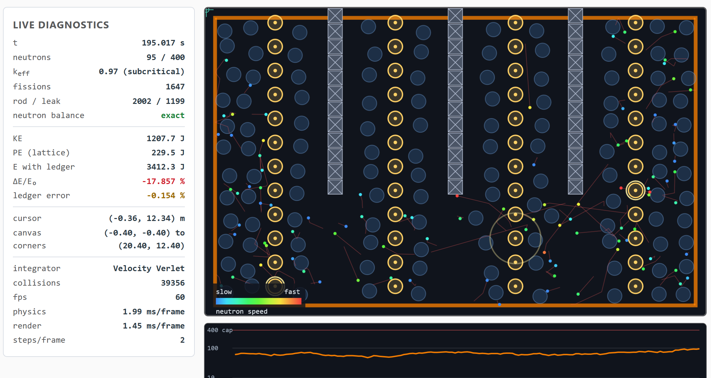
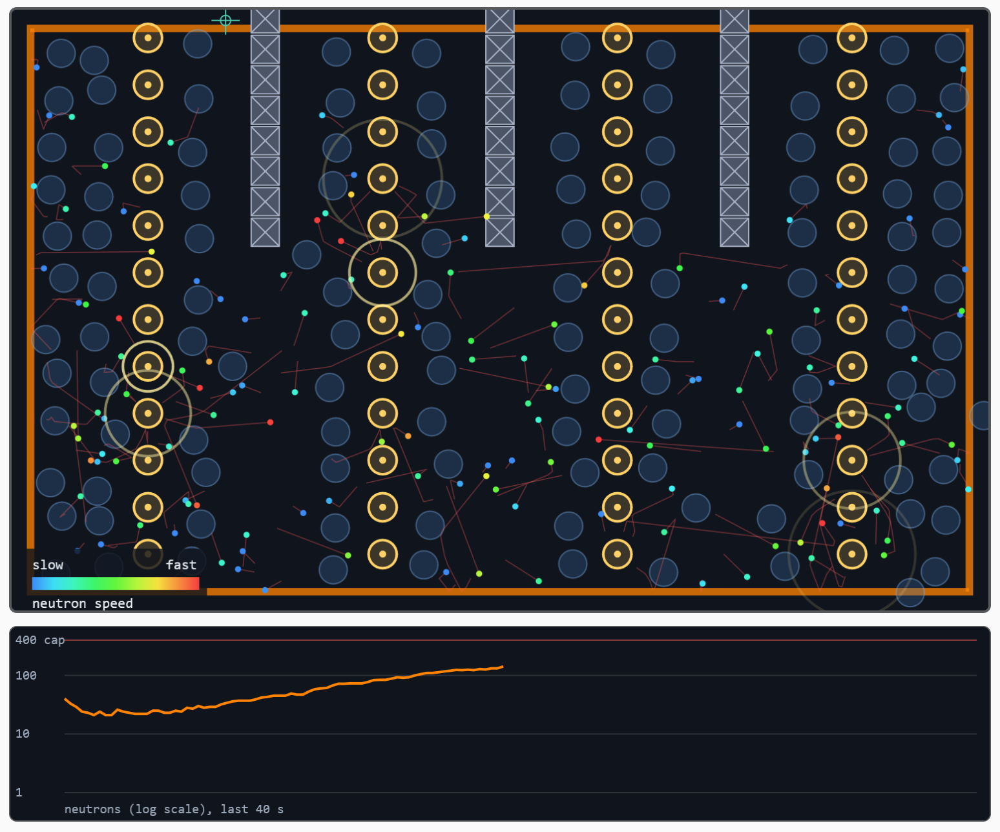

# Lab 10: Interactive Simulation (Block 3 Checkpoint)

Name: Aidan Siddiqi
Date: 11/8/2026
Lab: PHYS 311 Module 10

**AI use disclaimer:** AI (Claude) was used in preparing this code and write-up for coding assistance, tidying up code, and improving code flow/organization. This is not to say that there was no human work done; all of it included input and assistance from myself and many iterations and human attempts are consolidated into what is seen here.

Live link: `https://asiddiqi5.github.io/phys311/labs/lab10/`

The project is a toy reactor core, the **Reactor Core Explorer**. It runs on my Lab 9 engine, which is copied in unchanged. All the new code is in `scenes/reactor.js`, `input.js`, `ui.js`, `main.js` and three new files in `render/`.

## A1: Coordinate-Correct Input

`eventToWorld()` in `input.js` does two steps. It first turns the viewport position into canvas pixels with the ratio `canvas.width / rect.width`, which handles CSS scaling and the retina buffer. Then it runs my camera backwards with `camera.screenToWorld`. All input uses `pointerdown`, `pointermove` and `pointerup`, so a mouse, a finger and a stylus all work.

The Live diagnostics panel shows the cursor's physics coordinates, and the canvas draws a crosshair at that point. The panel also shows the physics coordinates of the four canvas corners. The canvas is fitted with no padding, so the corners should equal the view bounds, (-0.40, -0.40) to (20.40, 12.40), to within one pixel.

| Corner | Expected (x, y) in m | Readout When I Clicked it |
|---|---|---|
| bottom-left | (-0.40, -0.40) | (-0.38, -0.38) |
| bottom-right | (20.40, -0.40) | (20.38, -0.38) |
| top-left | (-0.40, 12.40) | (-0.34, 12.34) |
| top-right | (20.40, 12.40) | (20.38, 12.35) |

## A2: Simulation Controls

| Control | Key | What I Checked |
|---|---|---|
| Pause / Resume | Space | Physics freezes, the picture keeps drawing. The button label follows the state |
| Single step | . | Pauses first, then advances exactly one DT. Worst gap between the clock change and DT is 2.95e-17 s (1.9e-16 in the stub-browser test) |
| Reset | R | Rebuilds the core from the same seed, keeps the sliders, and takes a new energy baseline. After a reset the energy drift reads 0 |
| Speed 0.25x to 2x | - and + | Scales the clock that feeds the accumulator. DT never changes. At 2x the page covers 2.03 times the simulated time of 1x |
| Integrator | menu | Euler, Euler-Cromer or Velocity Verlet, switched live with no reset |

Speed scales time and never DT, so physics still advances in identical slices.

## A3: Parameter Sliders

Four sliders change the physics live, and each has a readout that updates as it moves and a spoken value (`aria-valuetext`). All values go through `parseFloat` and are clamped in code as well as in the HTML.

| Slider | Range | Why the Upper Bound |
|---|---|---|
| Control rods | 0 to 100 % | 100 % puts the rods to the floor of the core |
| Moderator | 0 to 100 % | 100 % fills every lattice site |
| Reflector | 0 to 95 % | At 100 %,  nothing could ever leak |
| Neutron source | 0 to 20 per s | More than this fills the 400 neutron cap from the source |
| Speed | 0.25x to 2x | A frame is clamped at 0.25 s, so more than 2x only drops time |
| Timestep DT | 1/480, 1/240, 1/120, 1/60 s | See below |

**How I Chose the Upper Bound for DT:** There are two stability limits.

- The mouse spring has k = 200 and m = 1. The lesson's condition is deltat < 2 / sqrt(k/m) = 2 / 14.1 = 0.141 s. The lattice springs (k = 120) allow Δt < 2 / sqrt(120) = 0.183 s.
- A neutron must not skip over an atom in one step. It tunnels if |v| deltat is larger than the contact distance, which is the neutron radius plus the atom radius, 0.06 + 0.30 = 0.36 m. I limit neutron speed to 20 m/s, so deltat must be under 0.36 / 20 = 0.018 s.
The coarsest DT I allow is 1/60 s = 0.0167 s, where a neutron at the speed limit moves 0.333 m per step, just under 0.36 m. This is the same condition as the Week 9 tunneling rule.

## B1: Grabbing, Throwing and the Slingshot

**Grab:** Pressing on a neutron or a moderator atom adds a damped spring toward the cursor as a Force (`MouseSpring` in `input.js`, k = 200, c = 20). The body still collides. A released neutron keeps the velocity it had. The mouse is an outside force, so its work is booked in the energy ledger.

**Slingshot:** Press on empty space, pull back, and release. The neutron's speed is 4 times the pull length, capped at 14 m/s. A dashed line shows the pull and a solid line shows the straight path to the first thing the neutron will touch, with a ring there and a label. Between collisions, a neutron moves in a straight line.

**Why Teleport-Dragging Breaks the Physics:** I added a "Teleport drag" checkbox so I could try it. It sets `body.pos` directly to the cursor. Two issues: 

1. **No collisions, so bodies pass through things, and release gives no velocity.** In the test I dragged a neutron straight across two fuel columns at 0.35 m per step. There were 0 fissions, because the neutron jumped over every atom.
2. **Energy is meaningless.** With teleport on, I dragged a moderator atom 3 m out of its site. The atom's spring now holds 1/2 k d^2 = 540 J, so the energy ledger jumped from 0 to 540 J in one step.

## B2: Visuals that Reveal Physics

Each one has its own checkbox in the Display section.

| Visual | What a viewer can now understand that they could not before |
|---|---|
| Neutron Trails (alpha fade) | The path history. Long straight runs between collisions and sharp turns at each collision, so you can see a neutron go through the lattice |
| Color by Speed, with a Legend (blue slow, red fast) | Moderation. A red neutron turns green and then blue after a few collisions with moderator atoms, and the blue ones are the slow neutrons that cause fission |
| Fission Flashes | Where and when fissions happen. Above critical the flashes get visibly more frequent |
| Velocity Arrows | Direction and speed as a vector. A collision shows up as an arrow that suddenly turns |
| Population Chart (log scale) | Exponential growth and decay as a straight line. The slope shows how far from critical the core is, and the line flattens at the 400 cap |

The legend uses words as well as color, and fuel, rods and moderator are told apart by shape (ring, square, disc) as well as color.

## B3: Responsive and Accessible

- The canvas buffer is the CSS width times `devicePixelRatio`, and it keeps the world in view on resize. CSS gives it `width: 100%; height: auto`, and `touch-action: none` stops a drag from scrolling the page. The layout becomes one column below 860 px.
- Every control is a real HTML element. Tab reaches all of them, and a visible orange focus ring shows where you are.
- Keyboard: Space, ., R, - and +, F, S, T and Esc. F fires a neutron, which is the keyboard route to the slingshot.
- The canvas has `tabindex="0"`, an `aria-label` and descriptive text inside the `<canvas>` element. A polite live region announces pause, reset, firing, SCRAM and speed changes.
- The speed legend has words, object as differe shapes, and k_eff is printed with the word "subcritical", "critical" or "supercritical".
- `prefers-reduced-motion` starts the page paused, with trails and flashes off.

**Gap:** Grabbing and throwing a neutron needs a pointer. A keyboard user can fire neutrons but cannot easily grab one.

**The Unplugged-Mouse Test:** I unplugged the mouse and tried to pause and resume, step, reset, change the rods, change the integrator, and fire a neutron. Everything worked with the keyboard alone. I did not find any control that needed the mouse, and none of the buttons had issues.

## Part C: Make it Worth Visiting

**Purpose:** "A toy nuclear reactor core. Slide the control rods and the moderator to push the chain reaction above or below critical (k = 1) and watch the neutron population respond. Fire neutrons with the mouse."

**Direction:** Explorable. The surprise is that taking out the moderator, or sliding the rods in shuts the chain reaction down and sliding them out lets it run away until it hits the cap.

**Physics from Blocks 1 and 2.**

- **Week 4 Collisions:** Every neutron atom collision is an elastic two-body collision. Moderator atoms are light as a neutron, so a neutron keeps on average one third of its energy per collision. That is the moderator.
- **Week 2 Energy and Integrators:** A live energy ledger and the integrator menu. Euler fails.
- **Week 3 Springs:** The moderator lattice is atoms on springs with damping and kicks as a heat bath.

**Quantitative Validation:** Results from `node tests/validate.js` (47 checks) and `node tests/smoke-dom.js` (53 checks).

| Result | Value |
|---|---|
| Mean energy kept per collision vs 1 - 8A / (3 (1 + A)^2), for A = 1, 2, 12, 235 | 0.3342 / 0.4069 / 0.8104 / 0.9888 against 0.3333 / 0.4074 / 0.8107 / 0.9887 |
| Momentum in every collision | Conserved to 2.2e-16 |
| Neutron balance (an integer identity) | Exact in every run, including 4000 random actions and a runaway |
| Energy ledger error over 60 s, DT = 1/120, as a fraction of the energy created | Velocity Verlet 0.187 %, Euler-Cromer 0.497 %, Euler 23.7 % |
| Control rods 0 / 40 / 100 % | k = 1.46 / 1.02 / 0.78 |
| Moderator 0 / 50 / 100 % | k = 0.28 / 1.22 / 1.46. With no moderator, 100 neutrons die out |

The collision formula is a test of the engine's collision code. It uses the engine's own `resolveContact` with a random impact parameter.

**Note on the Energy Ledger.** The leftover error is most likely the engine's push-apart step moving a spring-held atom a little, which is an O(DT) artifact. It shrinks as DT shrinks and grows with the lattice stiffness. Reactions alone (no moderator) book energy exactly. The error also depends on the integrator and the DT:

| After 20 s | DT = 1/480 | 1/240 | 1/120 | 1/60 |
|---|---|---|---|---|
| Velocity Verlet | 0.04 % | 0.11 % | 0.21 % | 0.23 % |
| Euler-Cromer | 0.14 % | 0.25 % | 0.54 % | 2.19 % |
| Euler | 5.2 % | 11.8 % | 30.0 % | 70.3 % |

The HUD turns red past 1 %. Verlet stays green at every DT the page allows. Euler-Cromer goes red only at the coarsest step, and Euler fails at every step.

## Robustness Log
| What I Tried | What Happened |
|---|---|
| Runaway chain, rods out and reflector at 90 %, 40 s | Peak 400 neutrons (the cap), 1460 births dropped, no NaN, about 1.3 ms per step, balance exact |
| Random actions, sliders to their extremes, moderator toggled, SCRAM, fire, integrator changes, DT changes, mouse grabs, resets, uneven frames, stalls | No NaN, no overflow, balance exact, worst energy ledger error 1.80 % (Euler-Cromer at DT = 1/60 alone reads about 2 %) |
| Random actions through the real controls of `main.js`: sliders, keys, buttons, pointer press-drag-release and cancel, window resize | No console error, no NaN, loop still running |
| Euler for 60 s | Stays finite. The energy error is 23.7 %, so it fails visibly but does not crash |
| Fire spam at the cap | Neutrons are refused and the page says so |

**Two Bugs the Abuse Tests Found, now Fixed:**
1. A fractional value on the DT slider gave a time step of `undefined`, and the clock became NaN. The DT index is now rounded.
2. My first way of booking the mouse's work gave an error larger than the neutron's whole energy. The damping term is large and cancels the spring's push. I replaced it with the exact work identity for the integrator, and the error is now 2.7e-15.

What I tried in real browsers:

| What I Tried | Browser or Device | What Happened |
|---|---|---|
| Spammed every button and key | Device | Everything responded and nothing froze. The console stayed clean. |
| Maxed every slider | Device | With rods, moderator, reflector and source all at maximum, the population settled at a few hundred neutrons, below the 400 cap. |
| Dragged a neutron into a wall and into fuel at speed | Device | At the core edge it was reflected or lost, depending on the reflector setting. In fuel it reacted (fission or bounce), and the grab ended by itself if it was absorbed. |
| Resized the window while running | Device | The canvas rescaled and kept its shape. The simulation kept running without a glitch. |
| Opened it on a phone | Phone | The page switched to one column and touch worked for fire and grab. The text was readable. |

## Honest Note on Engine Changes

I changed no file in `engine/` or in the three Lab 9 files in `render/`. The reactor is a `World` subclass in `scenes/reactor.js`, and the new drawing code subclasses the Lab 9 `Renderer`. Neutrons use the engine's collision `group` so they skip each other, fuel and rods use `isStatic`, and the moderator uses an ordinary force.

One place repeats engine code. `ReactorWorld.step()` repeats the engine's five stages, because I needed to read velocities between "integrate" and "collide" to book the mouse's work exactly.
