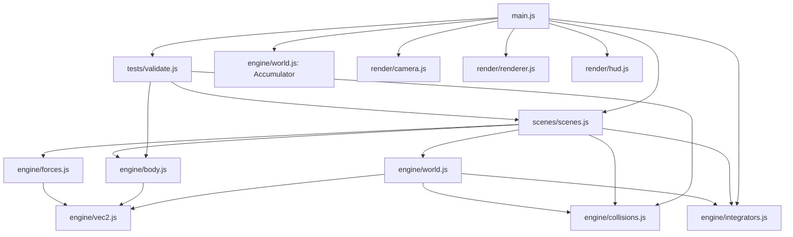

# Lab 9: Multi-Body Browser Simulation

Name: 
Date: 
Lab: PHYS 311 Module 9

**AI use disclaimer:** AI (Claude) was used in preparing this code and write-up for coding assistance, tidying up code, and improving code flow/organization. This is not to say that there was no human work done; all of it included input and assistance from myself and many iterations and human attempts are consolidated into what is seen here.

Live link: https://YOUR-USERNAME.github.io/phys311/labs/lab09/

The structure follows the Week 9 reference engine. Bonus attempted: spatial grid broad phase.

All numbers below come from `node tests/validate.js` and the in-page buttons, which give identical digits.

## Module dependency diagram

No arrow goes from `engine/` into `render/`. Only `main.js` imports both. A search of `engine/` for `ctx`, `canvas`, `document`, `window` and `requestAnimationFrame` finds nothing, and the whole engine runs in Node.

## Part A: The modular engine

`World.step(dt)` runs the five stages: clear forces, apply forces, integrate, collide (walls, then pairs), advance time. Stages 1 and 2 are `computeForces()`, because Velocity Verlet calls it again mid-step.

There are four forces with `apply(world)`: Gravity, Drag, Spring and NewtonGravity. The conservative ones also have `potentialEnergy(world)`. Internal forces are applied as `a.applyForce(F)` and `b.applyForce(F.neg())` on back-to-back lines, so momentum conservation is built into the forces. World never checks a force's type.

The integrators (Euler, Euler-Cromer, Velocity Verlet) share `step(world, dt)`. Switching is one line, `world.integrator = new VelocityVerlet()`, and the dropdown does it live.

The HUD compares against `world.baseline`, which `main.js` captures once when the scene is built. Capturing it inside the frame loop would make the drift read zero forever.

## Part B1: Collision pipeline and the jitter bug

`BoxBounds` clamps a body back inside the walls, then reflects the outward velocity with factor e. `resolveContact` finds the normal and the closing speed vn. If the pair is separating, it only pushes them apart. Otherwise it applies the restitution impulse, then pushes them apart. The push is split by inverse mass, so it adds no momentum. Static bodies have inverse mass zero. The ball pit uses five static pegs.

**Jitter demo.** Ball pit, 100 balls, e = 0.6. I let it settle for 20 s, then averaged KE over the next 2 s.

| Separating guard | Mean KE, t = 20 to 22 s | Fastest ball |
|---|---|---|
| On | 0.429 J | 0.27 m/s |
| Off | 1.079 J | 0.37 m/s |

The two still images look almost the same, so the KE is the real evidence. A pile that should be resting has 2.5 times more KE without the guard. Without it, a pair that overlaps but is already moving apart gets another impulse. That flips their relative velocity and sends them back into each other, so the pile keeps buzzing. With the guard, a separating pair only gets pushed out.

`[Optional: add your own 5 second screen recording of the jitter]`

## Part B2: Conservation HUD and validation

**Momentum and energy tests.** 20 balls in a box, no gravity, DT = 1/240 s, 60 s.

| Condition | Pair collisions | Wall hits | \|p\| at t = 0 | \|p\| at t = 60 s | \|p − J_ext\| at t = 0 | \|p − J_ext\| at t = 60 s |
|---|---|---|---|---|---|---|
| e = 1 | 295 | 344 | 20.704000742217 | 23.149931248554 | 20.704000742217 | 20.704000742217 |
| e = 0.8 | 92 | 126 | 20.704000742217 | 1.960526381110 | 20.704000742217 | 20.704000742217 |

| Condition | E at t = 0 | E at t = 60 s | ΔE/E0 | Steps where E rose |
|---|---|---|---|---|
| e = 1 | 134.158845344895 J | 134.158845344894 J | -1.7e-15 | 0 |
| e = 0.8 | 134.158845344895 J | 2.979713778530 J | -97.8 % | 0 |

**Why |p| changes.** The handout says |p| should stay constant in the box. Plain |p| cannot, because the walls push on the balls. A wall is an outside force. So the engine adds up the momentum the walls give, J_ext, and checks p − J_ext instead. It holds to 1.5e-15 (e = 1) and 1.7e-16 (e = 0.8) relative change. That is round-off, so the pair impulse is symmetric.

To check plain |p| too, I turned the walls off and started the balls bunched together:

| e | \|Δp\|/\|p0\| after 10 s | KE kept | Collisions |
|---|---|---|---|
| 1.0 | 2.3e-16 | 100.00 % | 12 |
| 0.8 | 1.7e-16 | 87.90 % | 14 |
| 0.5 | 4.3e-17 | 77.30 % | 15 |
| 0.0 | 1.1e-17 | 75.56 % | 13 |

**Why the two laws behave differently.** Every pair impulse is equal and opposite, so it cancels in the total momentum for any e. Energy is only kept at e = 1. For e < 1, each collision removes part of the KE along the normal, and nothing ever adds it back. So E falls and never rises, while p − J_ext does not move.

## Part C: Three scenes from one engine

All scenes are in `scenes/scenes.js`. The dropdown switches them at runtime. The integrator switch, e slider and HUD work in every scene.

### Scene 1: Billiards box

20 to 500 balls with masses from 1 to 2 kg. Diagnostic: p − J_ext stays fixed, and E falls monotonically for e < 1 (tables above).

### Scene 2: Gravitational N-body

A star (m = 1), five planets and a moon, G = 1, softening 0.005, DT = 1/240 s. The star gets the opposite of the planets' momentum, so the center of mass stays still. My first version had the planets too close together, and one got thrown out to r = 7.7. I respaced them several mutual Hill radii apart.

| Integrator | Max \|ΔE/E0\| over 60 s | Largest change in a planet's distance from the star | \|p\| |
|---|---|---|---|
| Velocity Verlet | 4.4e-7 | 4.6 % | 3e-17 |
| Euler-Cromer | 9.4e-5 | 5.0 % | 4e-18 |
| Euler | 2.2e-1 | 105 % | 4e-18 |

Verlet keeps the energy bounded with no escape and no NaN for 60 s. Euler drifts and the inner planets spiral out, as in Lab 5. Momentum stays at round-off for every integrator, because every pull is applied as +F and −F.

### Scene 3: Diatomic molecules

Eight molecules, each a heavy atom (3 kg) and a light atom (1 kg) on a spring (k = 200 N/m, rest length 0.8 m). This is the HCl bond from my Block 1 checkpoint, now with many molecules colliding. Atoms in the same molecule share a `group`, so they do not collide with each other.

**Diagnostic.** No gravity or drag, and e = 1. So KE + spring PE should hold, and p − J_ext should hold because springs and pair impulses are internal.

| DT | Max \|ΔE/E0\| over 60 s (Verlet) | \|Δ(p − J_ext)\|/\|p0\| |
|---|---|---|
| 1/120 | 5.9e-2 | 5.4e-15 |
| 1/240 | 3.2e-2 | 1.4e-14 |
| 1/480 | 5.4e-3 | 9.6e-15 |

Momentum holds to round-off at every step. Energy does not hold as well at large DT. Clamping an atom to the wall moves it without moving its partner. That changes the bond length, which changes the spring energy. The atom overshoots the wall by less at smaller DT, so the error shrinks. This scene defaults to DT = 1/480, where it stays under 1%.

## Performance report

Scene 1, DT = 1/240 s, so 4 physics steps per frame at 60 fps. Measured with the Scaling benchmark button in Chromium.

| Bodies | Brute checks/step | Brute physics (ms/frame) | Hash checks/step | Hash physics (ms/frame) | Render (ms/frame) | fps, brute |
|---|---|---|---|---|---|---|
| 20 | 190 | 0.03 | 1 | 0.14 | 0.01 | 60 |
| 50 | 1225 | 0.24 | 21 | 0.19 | 0.01 | 60 |
| 100 | 4950 | 1.26 | 36 | 0.38 | 0.04 | 60 |
| 200 | 19900 | 2.12 | 159 | 0.68 | 0.04 | 60 |
| 500 | 124750 | 34.92 | 384 | 1.91 | 0.08 to 0.17 | 29 |

`[Optional: re-run the benchmark on your own machine and replace these numbers]`

**Bottleneck.** Physics is the bottleneck. Render stays under 0.2 ms. Brute-force checks are exactly N(N−1)/2. From 200 to 500 bodies, O(N²) predicts 6.3 times more work. The time grew 16.5 times. That is worse than N², probably because `bruteForcePairs` builds a new array of 124,750 pairs every step, which the garbage collector then has to clear.

**Largest body count at 60 fps.** With brute force it is about 400 bodies (13 ms per frame). At 500 it is 35 ms, past the 16.7 ms budget. The first fix is the broad phase.

## Bonus: spatial grid broad phase

The hash puts bodies in cells of size 2 × the largest radius and only pairs bodies in neighboring cells. I sort its pairs into the same order brute force uses. That way switching broad phase cannot change the order collisions are resolved in.

| Bodies | Brute (ms/frame) | Hash (ms/frame) | Speedup | Checks/step, brute vs hash |
|---|---|---|---|---|
| 200 | 2.12 | 0.68 | 3.1× | 19900 vs 159 |
| 500 | 34.92 | 1.91 | 18× | 124750 vs 384 |

**Same physics.** 200 balls for 5 s with each broad phase: both had 2008 collisions, and the largest position difference was exactly 0. The two runs are bit-identical, so the grid does not change the physics.

## Engine changes a scene forced

No scene needed an engine edit in the end, but two engine features came from building scenes:

- `group` on Body came from Scene 3. Without it, the two atoms of a molecule would collide with each other.
- `isInternal` on forces came from the ball pit. The HUD showed a huge p − J_ext change there, because gravity also adds momentum from outside. Spring and NewtonGravity now mark themselves internal, and the HUD shows n/a when an outside force acts. World still never checks a force's type.
